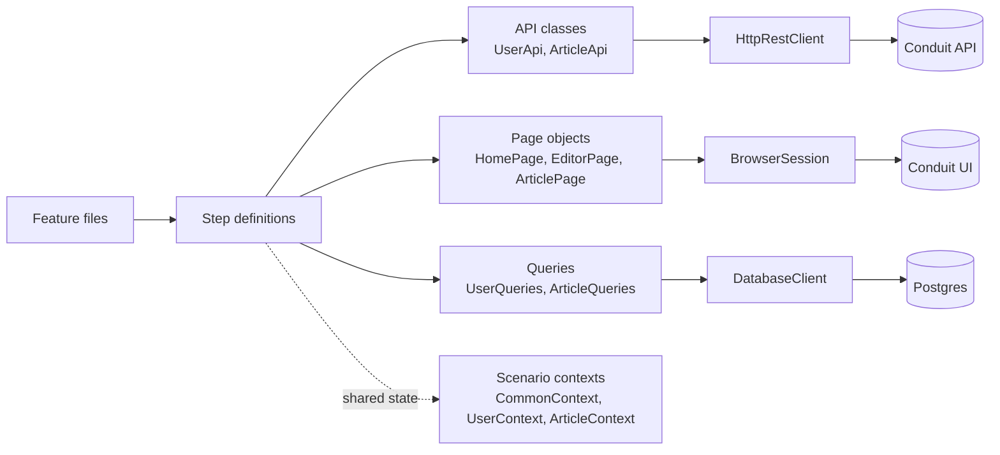

# Demo Automation Framework

BDD test suite for the [Conduit (RealWorld)](https://github.com/gothinkster/realworld) app, written in Java. It tests
the REST API, the web UI and the Postgres database underneath. Features run in parallel and clean up their own data.

[](https://github.com/bbankita/demo-automation-framework/actions/workflows/tests.yml)


## Highlights

- **API, UI and DB in one suite.** UI tests don't stop at what the page shows. After editing an article title, the
  test checks Postgres for the new slug.
- **Safe to run in parallel.** Each scenario gets its own contexts, HTTP client and browser through PicoContainer. No
  statics, no `ThreadLocal`.
- **Auth edge cases.** Missing, malformed and expired JWTs, plus a token whose user was deleted after it was issued.
- **Login skips the UI.** UI tests log in through the API and drop the session into `localStorage`. They're faster
  and fail for fewer unrelated reasons.
- **No sleeps.** Every UI action waits explicitly. Async checks poll with Awaitility.
- **Cleans up after itself.** Articles a scenario creates get deleted in an `@After` hook. Generated users carry a
  run tag, so leftovers are easy to find.
- **Useful failures.** A failed UI scenario attaches a screenshot. A failed API scenario attaches every request and
  response it made, with tokens masked.
- **Strict build.** A failed scenario fails the build. So does a run that matched zero scenarios.

## System under test

| Component | URL | Notes |
|---|---|---|
| Conduit API | `http://localhost:3001/api` | `Authorization: Token <jwt>`, validation errors come back as 422 |
| Conduit UI | `http://localhost:3001` | Editor and article pages |
| Postgres | `localhost:5432/conduit` | Used for setup and verification |

Runs locally in Docker. Setup lives in
[bbankita/conduit-realworld-example-app](https://github.com/bbankita/conduit-realworld-example-app).

## Test coverage

| Feature | Layer | Scenarios |
|---|---|---|
| Login | API | valid login · missing fields (outline) · wrong credentials (outline) · malformed email |
| Registration | API | valid registration · missing fields (outline) · duplicate email/username |
| Current user | API | valid token · missing/invalid header (outline) · expired JWT · user deleted after token issued |
| Article authoring | UI + DB | publish with tags, check markdown renders · edit title, check new slug in DB and at new URL |

## Tech stack

| What | Tools |
|---|---|
| BDD / runner | Cucumber 7, JUnit 4, Surefire (parallel) |
| DI | PicoContainer |
| API | Rest Assured 5, Jackson, java-jwt |
| UI | Selenium 4 (Selenium Manager handles drivers), Page Objects |
| DB | PostgreSQL JDBC |
| Assertions / waits | AssertJ (incl. soft assertions), Awaitility |
| Test data | Datafaker, Lombok builders |
| Logs / reports | SLF4J + Logback, Cucumber HTML, Cluecumber |

## Architecture



```
src/test/java/com/framework/
├── backend/
│   ├── api/              BaseApi (status checks), UserApi, ArticleApi
│   ├── context/          CommonContext (responses, HTTP log), UserContext, ArticleContext
│   ├── model/            request/response POJOs
│   ├── stepdefinitions/  auth, user management, articles, shared API assertions
│   └── utilities/        HttpRestClient, JwtTokenFactory/Parser, UserQueries, ArticleQueries
├── frontend/
│   ├── page/             BasePage (wait-wrapped actions), HomePage, EditorPage, ArticlePage
│   ├── stepdefinitions/  BrowserSteps (hooks), CommonSteps, ArticleSteps
│   └── utilities/        BrowserSession, DriverManager + Chrome/Firefox, DriverManagerFactory
├── common/
│   ├── stepdefinitions/  SharedHooks (cleanup, failure attachments)
│   └── utilities/        ConfigurationReader, DatabaseClient, TestDataFactory, DataTableTransformers, MarkdownParser, LogHelper
├── configuration/        typed config POJOs
├── exceptions/           FrameworkException, UnsupportedBrowserTypeException
└── testrunners/          BaseTestRunner, TestRunner, FailedScenarioRunner
src/test/resources/
├── config/qa.json        per-env settings, ${ENV_VAR:default} placeholders
├── features/api/         authentication/, user_management/
├── features/ui/          article authoring
├── schemas/              JSON schemas for contract checks
└── logback-test.xml
```

### Design decisions

- **One way to send requests.** Everything goes through `HttpRestClient`, and each call starts from a fresh
  `given()` on an immutable base spec. Headers and auth from one call can't leak into the next. `BaseApi.requireStatus`
  turns an unexpected status into an exception that carries the response body.
- **Contexts, not statics.** Steps share state through scenario-scoped context objects. That's the reason
  `parallel=both` works.
- **One browser per scenario.** `BrowserSession` is injected into the hooks and every page object. The first browser
  start is synchronized, so parallel threads don't fight over Selenium Manager's driver download.
- **Locators are plain `By` constants.** `BasePage` wraps click/type/getText in explicit waits with one configurable
  timeout. When a wait times out, the error names the element and the URL.
- **Traceable data.** `TestDataFactory` adds a per-run `RUN_TAG` to usernames and article titles. Conduit has no
  delete-user endpoint, so the tag is the only way to find leftover users.
- **No secrets in git.** Config values come from env vars first, then a git-ignored `.env`, then a safe default.

## Getting started

**You need:** Java 11+, Maven 3.6.3+, Chrome or Firefox, and Conduit running locally (see the
[repo's README](https://github.com/bbankita/conduit-realworld-example-app) for the start command).

```bash
cp .env.example .env        # fill in test user, JWT secret, DB creds

mvn clean test -Dheadless=true                                  # everything
mvn clean test -Dcucumber.filter.tags="@api"                    # API only
mvn clean test -Dcucumber.filter.tags="@ui" -Dheadless=true     # UI only
mvn clean test -Dcucumber.filter.tags="@smoke"                  # smoke
mvn clean test -Dcucumber.filter.tags="@api and not @smoke"     # any tag expression works

mvn test -P rerun-failed-test-suite -Dheadless=true             # rerun last failures
mvn cluecumber:reporting                                        # merged report
```

### Run options

| Flag | Default | Notes |
|---|---|---|
| `-Denv` | `qa` | loads `config/<env>.json` |
| `-Dbrowser` | `chrome` | `chrome` or `firefox` |
| `-Dheadless` | `false` | |
| `-Dtimeout` | `10` (from config) | explicit-wait timeout, seconds |
| `-Dparallel.threads` | `4` | features run at once |
| `-Dcucumber.filter.tags` | all | any tag expression |
| `-DfailIfNoTests` | `true` | 0 scenarios run = failed build. Catches tag typos and startup errors |

### Configuration and secrets

`config/<env>.json` holds no secrets. Values can point at env vars: `${VAR}` (required) or `${VAR:default}`
(optional). Lookup order: env var → `.env` → default.

| Variable | For |
|---|---|
| `CONDUIT_API_BASE_URI` | API base URL (default `http://localhost:3001/api`) |
| `UI_BASE_URL` | UI base URL (default `http://localhost:3001`) |
| `TEST_USER_EMAIL` / `TEST_USER_USERNAME` / `TEST_USER_PASSWORD` | an existing Conduit user for UI and auth tests |
| `CONDUIT_JWT_KEY` | must match the container's JWT secret. Used to sign expired tokens |
| `CONDUIT_DB_URL` / `CONDUIT_DB_USERNAME` / `CONDUIT_DB_PASSWORD` | Postgres connection |

In CI, map these from your secret store (e.g. `CONDUIT_JWT_KEY: ${{ secrets.CONDUIT_JWT_KEY }}` in GitHub Actions).
Don't pass secrets as `-D` flags. They end up in shell history and Surefire reports.

## Reporting

| What | Where |
|---|---|
| Cucumber HTML | `target/cucumber-html/index.html` |
| Cluecumber (run + rerun merged) | `target/generated-report/index.html` |
| Rerun list | `target/failed-scenarios.txt` |
| Framework log | `target/framework.log` |

## CI

GitHub Actions runs the suite on every push and pull request to `main`. You can also start it by hand from the
Actions tab. The workflow lives in `.github/workflows/tests.yml`.

Each run:

1. Checks out this repo and the [Conduit app](https://github.com/bbankita/conduit-realworld-example-app).
2. Starts Conduit and Postgres with Docker Compose and waits until they're ready.
3. Runs the tests in headless Chrome. Scenarios tagged `@known-issue` are skipped.
4. Uploads the reports and log as a `test-report` artifact, even when tests fail. Download it from the run's
   Summary page.

No secrets are needed. The defaults in `config/qa.json` match the Conduit container's.

## Tags

| Tag | Meaning |
|---|---|
| `@api` / `@ui` | layer. UI features need `@ui`, which starts the browser |
| `@smoke` | happy paths |
| `@auth`, `@login`, `@registration`, `@user-management` | API areas |
| `@conduit`, `@articles` | UI areas |

## Roadmap

- docker-compose for Conduit so setup is one command
- More UI: delete article, editor validation, non-authors can't edit/delete

## Troubleshooting

- **Everything fails with connection errors:** Conduit isn't running, or `:3001`/`:5432` isn't reachable.
- **Expired-JWT test gets the wrong 401:** `CONDUIT_JWT_KEY` doesn't match the container's secret.
